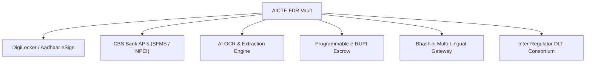

# AICTE FDR Vault - Future Scope & Strategic Roadmap

## 1. Vision & Strategic Alignment
The **AICTE FDR Vault** transforms a legacy, manual paper-trail workflow for security deposits and fixed deposit receipts into a real-time, transparent, and auditable digital infrastructure. The next phases of evolution expand this platform into an end-to-end autonomous compliance and banking settlement gateway for the Government of India.

---

## 2. Near-Term Innovations (Phase 2 - 6 to 12 Months)

### 2.1 DigiLocker & National Academic Depository (NAD) Integration
- **Direct Document Pull**: Institutions can link their DigiLocker Organization account to pull verified registration certificates, board resolutions, and council approvals without manual file uploads.
- **Aadhaar e-Sign (MeitY Approved)**: Authorized signatories of institutions and AICTE approving authorities can digitally sign release requests and orders using Aadhaar OTP e-Sign or Class-3 Digital Signature Certificates (DSC).

### 2.2 Direct Core Banking System (CBS) APIs & SFMS
- **Direct Bank Integration**: Integration with the RBI's **SFMS (Structured Financial Messaging System)** and Open Banking APIs of major public sector banks (State Bank of India, Punjab National Bank, Canara Bank, Bank of Baroda).
- **Automated Lien Marking**: AICTE can send an automated electronic Lien-Mark request directly to the bank’s Core Banking Solution upon FDR registration, eliminating physical lien letters.
- **Auto-Verification of Active Deposits**: Periodic API pings to banks to detect premature liquidation, encashment, or branch transfers without manual institution reporting.

### 2.3 Intelligent OCR & Automated Document Audit
- **Automated Data Extraction**: Ingestion of FDR receipt scans through an OCR pipeline (Tesseract / AICTE Bhasha Tech stack) to extract:
  - FDR Certificate Number
  - Bank Name & Branch IFSC
  - Principal Amount and Maturity Sum
  - Issue and Maturity Dates
- **Zero-Touch Cross-Verification**: Extracted OCR parameters are immediately validated against the form input; any mismatch is flagged to the Verifier in yellow highlight.

---

## 3. Medium to Long-Term Vision (Phase 3 - 12 to 24 Months)

### 3.1 Programmable e-RUPI / CBDC Digital Deposits
- **Targeted Escrow Releases**: Leveraging RBI's **Central Bank Digital Currency (CBDC)** and **e-RUPI** purpose-bound tokens. Security deposits can be held in programmable digital currency escrows that automatically release to the institution's verified corporate account upon fulfillment of accreditation milestones or tenure maturity.
- **Zero UTR Delays**: Elimination of multi-day clearing delays through instantaneous central bank settlement.

### 3.2 Inter-Regulator Ledger Consortium (DLT / Blockchain)
- **Consortium Architecture**: A private permissioned **Hyperledger Fabric** network shared between:
  - AICTE (All India Council for Technical Education)
  - UGC (University Grants Commission)
  - Participating Schedule Commercial Banks
  - RBI / Ministry of Education
- **Immutable Multi-Agency Lien Register**: Prevents fraudulent multiple lien-marking on the same fixed deposit across different regulatory bodies.

### 3.3 Bhashini Multi-Lingual Interface
- Integration with the Government of India's **Bhashini** AI translation engine to provide full regional language localization in 12+ official Indian languages (Hindi, Marathi, Tamil, Telugu, Bengali, Gujarati, Kannada, etc.), easing compliance for regional college administrators.

---

## 4. Architectural Summary

