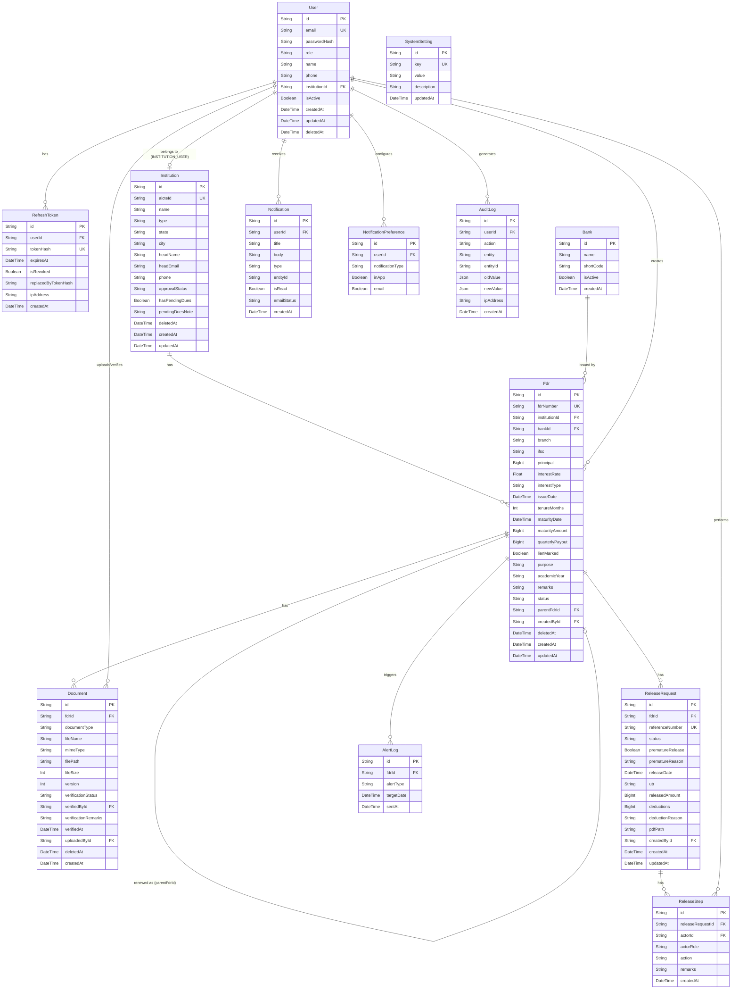

# AICTE FDR Vault — Build Plan

## Folder Structure

```
FDR/
├── package.json                    # root: setup + dev scripts
├── .gitignore
├── docs/
│   ├── SPEC.md
│   ├── PROGRESS.md
│   ├── PLAN.md
│   ├── DECISIONS.md
│   ├── SECURITY.md
│   ├── E2E_UI_LOG.md
│   ├── DEMO_SCRIPT.md
│   ├── FUTURE_SCOPE.md
│   ├── SIH_PPT_OUTLINE.md
│   ├── FINAL_CHECKLIST.md
│   └── screenshots/
├── backend/
│   ├── package.json
│   ├── tsconfig.json
│   ├── .env.example
│   ├── .env
│   ├── prisma/
│   │   ├── schema.prisma
│   │   ├── migrations/
│   │   └── seed.ts
│   ├── scripts/
│   │   └── e2e-release.ts
│   ├── uploads/                    # <institutionId>/<uuid>.<ext>
│   ├── src/
│   │   ├── index.ts               # app entry + server start
│   │   ├── app.ts                 # Express app (no listen)
│   │   ├── config.ts              # env validation (Zod)
│   │   ├── constants.ts           # Zod enums for all string fields
│   │   ├── logger.ts              # pino
│   │   ├── prisma.ts              # PrismaClient singleton
│   │   ├── middleware/
│   │   │   ├── auth.ts            # JWT verify, RBAC
│   │   │   ├── errorHandler.ts    # central error handler
│   │   │   ├── rateLimiter.ts
│   │   │   └── validate.ts        # Zod middleware
│   │   ├── utils/
│   │   │   ├── response.ts        # envelope helpers
│   │   │   ├── maturity.ts        # calculateMaturity(), addMonths()
│   │   │   ├── audit.ts           # appendAuditLog()
│   │   │   ├── crypto.ts          # hash, compare, tokens
│   │   │   ├── indianDate.ts      # Asia/Kolkata "today"
│   │   │   ├── pdf.ts             # Release Order PDF generator
│   │   │   ├── qrcode.ts          # QR code generator
│   │   │   └── mailer.ts          # nodemailer or console fallback
│   │   ├── routes/
│   │   │   ├── index.ts           # mount all routers
│   │   │   ├── auth.ts
│   │   │   ├── users.ts
│   │   │   ├── banks.ts
│   │   │   ├── institutions.ts
│   │   │   ├── fdrs.ts
│   │   │   ├── documents.ts
│   │   │   ├── renewals.ts
│   │   │   ├── releases.ts
│   │   │   ├── notifications.ts
│   │   │   ├── dashboard.ts
│   │   │   ├── reports.ts
│   │   │   ├── search.ts
│   │   │   ├── audit.ts
│   │   │   ├── settings.ts
│   │   │   ├── jobs.ts
│   │   │   └── public.ts
│   │   ├── controllers/           # (thin, delegate to services)
│   │   ├── services/
│   │   │   ├── auth.service.ts
│   │   │   ├── user.service.ts
│   │   │   ├── bank.service.ts
│   │   │   ├── institution.service.ts
│   │   │   ├── fdr.service.ts
│   │   │   ├── document.service.ts
│   │   │   ├── renewal.service.ts
│   │   │   ├── release.service.ts
│   │   │   ├── notification.service.ts
│   │   │   ├── dashboard.service.ts
│   │   │   ├── report.service.ts
│   │   │   ├── search.service.ts
│   │   │   ├── settings.service.ts
│   │   │   └── job.service.ts
│   │   ├── jobs/
│   │   │   ├── statusJob.ts       # daily 06:00 IST cron
│   │   │   └── alertJob.ts        # daily cron + on-demand
│   │   └── swagger/
│   │       └── swagger.ts
│   └── tests/
│       ├── maturity.test.ts
│       ├── auth.test.ts
│       ├── rbac.test.ts
│       ├── isolation.test.ts
│       ├── alerts.test.ts
│       ├── release.test.ts
│       └── upload.test.ts
└── frontend/
    ├── package.json
    ├── tsconfig.json
    ├── vite.config.ts
    ├── tailwind.config.ts
    ├── index.html
    ├── .env.example
    └── src/
        ├── main.tsx
        ├── App.tsx
        ├── api/
        │   ├── client.ts          # axios + token refresh interceptor
        │   └── endpoints/         # typed API functions per module
        ├── auth/
        │   ├── AuthContext.tsx
        │   └── useAuth.ts
        ├── components/
        │   ├── ui/                # design system primitives
        │   │   ├── Button.tsx
        │   │   ├── Input.tsx
        │   │   ├── Select.tsx
        │   │   ├── DatePicker.tsx
        │   │   ├── Modal.tsx
        │   │   ├── Drawer.tsx
        │   │   ├── Tabs.tsx
        │   │   ├── StatusChip.tsx
        │   │   ├── GlassCard.tsx
        │   │   ├── KpiCard.tsx
        │   │   ├── DataTable.tsx
        │   │   ├── Timeline.tsx
        │   │   ├── FileDropzone.tsx
        │   │   ├── PreviewModal.tsx
        │   │   ├── ConfirmDialog.tsx
        │   │   ├── CommandPalette.tsx
        │   │   ├── NotificationBell.tsx
        │   │   └── ThemeToggle.tsx
        │   ├── layout/
        │   │   ├── AppLayout.tsx
        │   │   ├── Sidebar.tsx
        │   │   ├── TopBar.tsx
        │   │   └── Breadcrumbs.tsx
        │   └── shared/
        │       ├── ErrorBoundary.tsx
        │       └── SkeletonLoader.tsx
        ├── pages/
        │   ├── Login.tsx
        │   ├── Dashboard.tsx
        │   ├── institutions/
        │   ├── fdrs/
        │   ├── calendar/
        │   ├── renewals/
        │   ├── documents/
        │   ├── releases/
        │   ├── reports/
        │   ├── notifications/
        │   ├── audit/
        │   ├── users/
        │   ├── settings/
        │   ├── profile/
        │   ├── public/
        │   └── NotFound.tsx
        ├── utils/
        │   ├── formatINR.ts
        │   ├── dates.ts
        │   └── permissions.ts
        ├── hooks/
        │   ├── useDebounce.ts
        │   └── usePagination.ts
        └── types/
            └── api.ts
```

---

## Mermaid ER Diagram



---

## API Endpoint List

### Auth
- `POST /api/v1/auth/login`
- `POST /api/v1/auth/refresh`
- `POST /api/v1/auth/logout`
- `GET  /api/v1/auth/me`
- `POST /api/v1/auth/change-password`
- `POST /api/v1/auth/forgot-password`

### Users (SUPER_ADMIN)
- `GET    /api/v1/users`
- `POST   /api/v1/users`
- `GET    /api/v1/users/:id`
- `PUT    /api/v1/users/:id`
- `DELETE /api/v1/users/:id`

### Banks (SUPER_ADMIN write, others read)
- `GET    /api/v1/banks`
- `POST   /api/v1/banks`
- `PUT    /api/v1/banks/:id`

### Institutions
- `GET    /api/v1/institutions`
- `POST   /api/v1/institutions`
- `GET    /api/v1/institutions/:id`
- `PUT    /api/v1/institutions/:id`
- `DELETE /api/v1/institutions/:id`
- `POST   /api/v1/institutions/import-csv`
- `PATCH  /api/v1/institutions/:id/pending-dues`

### FDRs
- `GET    /api/v1/fdrs`
- `POST   /api/v1/fdrs`
- `GET    /api/v1/fdrs/:id`
- `PUT    /api/v1/fdrs/:id`
- `DELETE /api/v1/fdrs/:id`
- `POST   /api/v1/fdrs/calculate`
- `GET    /api/v1/fdrs/renewal-due`
- `GET    /api/v1/fdrs/:id/chain`

### Documents
- `GET    /api/v1/fdrs/:fdrId/documents`
- `POST   /api/v1/fdrs/:fdrId/documents`
- `GET    /api/v1/documents/:id/download`
- `PATCH  /api/v1/documents/:id/verify`
- `PATCH  /api/v1/documents/:id/reject`
- `GET    /api/v1/documents/verification-queue`

### Renewals
- `POST   /api/v1/fdrs/:fdrId/renew`

### Release Requests
- `GET    /api/v1/releases`
- `POST   /api/v1/releases`
- `GET    /api/v1/releases/:id`
- `PATCH  /api/v1/releases/:id/submit`
- `PATCH  /api/v1/releases/:id/verify`
- `PATCH  /api/v1/releases/:id/approve`
- `PATCH  /api/v1/releases/:id/mark-released`
- `GET    /api/v1/releases/:id/pdf`

### Notifications
- `GET    /api/v1/notifications`
- `PATCH  /api/v1/notifications/:id/read`
- `PATCH  /api/v1/notifications/read-all`
- `GET    /api/v1/notifications/preferences`
- `PUT    /api/v1/notifications/preferences`

### Dashboard
- `GET    /api/v1/dashboard/kpis`
- `GET    /api/v1/dashboard/maturity-forecast`
- `GET    /api/v1/dashboard/bank-wise`
- `GET    /api/v1/dashboard/state-wise`
- `GET    /api/v1/dashboard/status-distribution`
- `GET    /api/v1/dashboard/deposit-trend`
- `GET    /api/v1/dashboard/recent-activity`
- `GET    /api/v1/dashboard/calendar`

### Reports
- `GET    /api/v1/reports/maturity`
- `GET    /api/v1/reports/bank-wise`
- `GET    /api/v1/reports/institution-ledger`
- `GET    /api/v1/reports/release-register`
- `GET    /api/v1/reports/audit`
- `GET    /api/v1/reports/:type/export?format=xlsx|csv|pdf`

### Search
- `GET    /api/v1/search?q=&type=`

### Audit Log
- `GET    /api/v1/audit`

### Settings
- `GET    /api/v1/settings`
- `PUT    /api/v1/settings/:key`

### Jobs (SUPER_ADMIN)
- `POST   /api/v1/jobs/status`
- `POST   /api/v1/jobs/alerts`

### Public (no auth)
- `GET    /api/v1/public/verify-release/:ref`

---

## Page List

| Page | Route | Roles |
|------|-------|-------|
| Login | `/login` | All |
| Dashboard | `/` | All |
| Institutions List | `/institutions` | All except INSTITUTION_USER |
| Institution Detail | `/institutions/:id` | All |
| FDR List | `/fdrs` | All |
| FDR Detail | `/fdrs/:id` | All |
| FDR Create | `/fdrs/new` | FINANCE_OFFICER, SUPER_ADMIN |
| FDR Edit | `/fdrs/:id/edit` | FINANCE_OFFICER, SUPER_ADMIN |
| Maturity Calendar | `/calendar` | All |
| Renewals | `/renewals` | All |
| Doc Verification Queue | `/documents/verify` | VERIFIER, SUPER_ADMIN |
| Release Requests List | `/releases` | All |
| Release Request Detail | `/releases/:id` | All |
| Release Create | `/releases/new` | FINANCE_OFFICER, SUPER_ADMIN |
| Reports | `/reports` | All except INSTITUTION_USER |
| Notifications | `/notifications` | All |
| Audit Log | `/audit` | AUDITOR, SUPER_ADMIN |
| Users & Roles | `/users` | SUPER_ADMIN |
| Settings | `/settings` | SUPER_ADMIN |
| Profile | `/profile` | All |
| Public Verify | `/verify-release/:ref` | Public |
| 404 | `*` | All |
